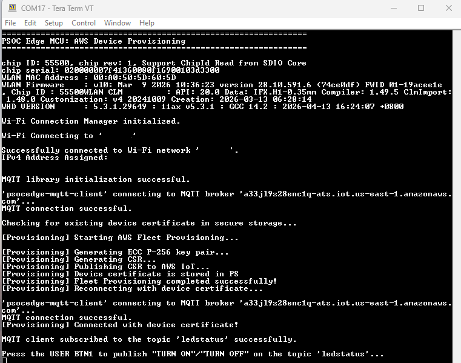

# PSOC&trade; Edge MCU: AWS device provisioning

This code example demonstrates AWS Fleet Provisioning by Claim using an Arm&reg; Cortex&reg;-M33 CPU on PSOC&trade; Edge MCU. It demonstrates the key generation, CSR generation, and retrieving of the device certificate from AWS. It also demonstrates how to securely store the keys and certificate on the device and reuse the device certificate for further connections to the AWS MQTT broker.

This code example has a three project structure: CM33 secure, CM33 non-secure, and CM55 projects. All three projects are programmed to the external QSPI flash and executed in Execute-in-Place (XIP) mode. Extended Boot launches the CM33 secure project from a fixed location in the external flash, which then configures the protection settings and launches the CM33 non-secure application. Additionally, CM33 non-secure application enables CM55 CPU and launches the CM55 application.

[View this README on GitHub.](https://github.com/Infineon/mtb-example-psoc-edge-aws-provisioning)

[Provide feedback on this code example.](https://yourvoice.infineon.com/jfe/form/SV_1NTns53sK2yiljn?Q_EED=eyJVbmlxdWUgRG9jIElkIjoiQ0UyNDMwODciLCJTcGVjIE51bWJlciI6IjAwMi00MzA4NyIsIkRvYyBUaXRsZSI6IlBTT0MmdHJhZGU7IEVkZ2UgTUNVOiBBV1MgZGV2aWNlIHByb3Zpc2lvbmluZyIsInJpZCI6InZhc3VtYS5uYXJheWFuYUBpbmZpbmVvbi5jb20iLCJEb2MgdmVyc2lvbiI6IjEuMC4wIiwiRG9jIExhbmd1YWdlIjoiRW5nbGlzaCIsIkRvYyBEaXZpc2lvbiI6Ik1DRCIsIkRvYyBCVSI6IklDVyIsIkRvYyBGYW1pbHkiOiJQU09DIn0=)

See the [Design and implementation](docs/design_and_implementation.md) for the functional description of this code example.


## Requirements

- [ModusToolbox&trade;](https://www.infineon.com/modustoolbox) v3.8 or later (tested with v3.8)
- Board support package (BSP) minimum required version for:
   - KIT_PSE84_EVAL_EPC2: v1.0.0
- Programming language: C
- Associated parts: All [PSOC&trade; Edge E84 MCU](https://www.infineon.com/products/microcontroller/32-bit-psoc-arm-cortex/32-bit-psoc-edge-arm/psoc-edge-e84) parts


## Supported toolchains (make variable 'TOOLCHAIN')

- GNU Arm&reg; Embedded Compiler v14.2.1 (`GCC_ARM`) – Default value of `TOOLCHAIN`
- Arm&reg; Compiler v6.22 (`ARM`)
- IAR C/C++ Compiler v9.70.4 (`IAR`)


## Supported kits (make variable 'TARGET')

- [PSOC&trade; Edge E84 Evaluation Kit](https://www.infineon.com/KIT_PSE84_EVAL) (`KIT_PSE84_EVAL_EPC2`) – Default value of `TARGET`


## Hardware setup

Ensure the following jumper and pin configuration on board.
- BOOT SW must be in the LOW/OFF position
- J20 and J21 must be in the tristate/not connected (NC) position


## Software setup

See the [ModusToolbox&trade; tools package installation guide](https://www.infineon.com/ModusToolboxInstallguide) for information about installing and configuring the tools package.

Install a terminal emulator if you do not have one. Instructions in this document use [Tera Term](https://teratermproject.github.io/index-en.html).


## Operation

See [Using the code example](docs/using_the_code_example.md) for instructions on creating a project, opening it in various supported IDEs, and performing tasks such as building, programming, and debugging the application within the respective IDEs.

> **Note:** Windows has a 260 character path length limit, so for the TF-M based applications to build successfully, ensure that <WorkspacePath>\<Application Name> path (including back slash) is less than or equal to 32 characters.

### 1. Add the Edge Protect Bootloader

1. Add **proj_bootloader** to this code example as a first step. Follow **Step 2** to **Step 9** in the **Operation** section of the [Edge Protect Bootloader](https://github.com/Infineon/mtb-example-edge-protect-bootloader) code example's *README.md* file
  
   > **Note:** [Edge Protect Bootloader](https://github.com/Infineon/mtb-example-edge-protect-bootloader) *README.md* describes how to add the bootloader to Basic Secure App. Add it to this code example instead

2. Ensure that COMBINE_SIGN_JSON points to the correct JSON file in the common.mk file for this code example

```
COMBINE_SIGN_JSON?=bsps/TARGET_APP_KIT_PSE84_EVAL_EPC2/config/GeneratedSource/boot_with_bldr.json
```

### 2. AWS Cloud setup 

As a pre-requisite, ensure that AWS CLI V2 is installed and configured using *aws configure* command. Ensure that you have appropriate IAM permissions for AWS IOT and IAM operations.

1. Execute the script aws_claim_cert_setup.sh in modus-shell terminal 

```
bash <app-directory>/scripts/aws_claim_cert_setup.sh [--region <region>] [--template <name>] [--policy <name>] [--out-dir <dir>]

```

This script automates the following steps:  

- Create IAM Role for Fleet Provisioning
- Create Device IoT Policy (attached to provisioned things)
- Create Fleet Provisioning Template
- Generate claim key
- Generate CSR for claim certificate
- Create claim certificate from CSR via AWS IoT
- Download Amazon Root CA
- Create Claim Certificate IoT Policy
- Attach claim policy to claim certificate

2. Copy or update the following credentials from the generated *<app-directory>/scripts/aws_claim_credentials.h* file into *<app-directory>proj_cm33_ns/app_mqtt/mqtt_client_config.h*

   - AWS_IOT_ENDPOINT
   - AWS_ROOT_CA_PEM
   - AWS_CLAIM_CERTIFICATE_PEM
   - AWS_CLAIM_PRIVATE_KEY_PEM
   - aws_client_key (raw bytes for PSA crypto import)

### 3. Update user configuration files  

   1. **Wi-Fi configuration:** Set the Wi-Fi credentials in *proj_cm33_ns/configs/wifi_config.h* – Modify the `WIFI_SSID`, `WIFI_PASSWORD`, and `WIFI_SECURITY` macros to match that of the Wi-Fi network you want to connect

   2. **MQTT configuration:** Set up the MQTT client and configure the credentials in *proj_cm33_ns/app_mqtt/mqtt_client_config.h*. Some of the important configuration macros are:

      - `MQTT_BROKER_ADDRESS`: Hostname of the MQTT broker

      - `MQTT_PORT`: Port number to use for the MQTT connection. Configure as '8883' for secure connections

      - `MQTT_SECURE_CONNECTION`: Set this macro as '1' to establish a secure (transport layer security (TLS)) connection to the MQTT broker

      - `MQTT_USERNAME` and `MQTT_PASSWORD`: User name and password for client authentication and authorization, if required by the MQTT broker. Note that this information is generally not encrypted and the password is sent in plain text. Therefore, this is not a recommended method for client authentication

      - `CLAIM_CERTIFICATE` and `CLAIM_PRIVATE_KEY`: Claim credentials used for initial client authentication with the AWS MQTT broker. Note that these information should be securely embedded into the device by the OEM during manufacturing

      - `ROOT_CA_CERTIFICATE`: Root CA certificate of the MQTT broker

      - 'CLAIM_KEY_DATA' : Raw private key data for claim credentials, imported using PSA API

      See the file *aws_claim_credentials.h* generated in [AWS Cloud setup](#2-aws-cloud-setup) to learn how to configure these macros for AWS IoT MQTT broker and claim credentials

   3. **Other configuration files:** You can optionally modify the configuration macros in the following file according to your application:

      - *core_mqtt_config.h* - This file contains the configuration macros for the MQTT library
      - *FreeRTOSConfig.h* - FreeRTOS configuration file
      - *ifx_psa_crypto_config* - PSA crypto configuration options
      - *ifx_tfm_config.h* - TF-M configuration file
      - *mbedtls_user_config.h* - MbedTLS configuration file
      - *wifi_config.h* - Wi-Fi configuration file

1. Connect the board to your PC using the provided USB cable through the KitProg3 USB connector

2.  Open a terminal program and select the KitProg3 COM port. Set the serial port parameters to 8N1 and 115200 baud

3. Program the board with the application. After programming, the application starts automatically. Confirm that "PSOC Edge MCU: AWS Device Provisioning" is displayed on the UART terminal

   **Figure 1. Terminal output on program startup**

   


## Related resources

Resources  | Links
-----------|----------------------------------
Application notes  | [AN235935](https://www.infineon.com/AN235935) – Getting started with PSOC&trade; Edge E84 MCU on ModusToolbox&trade; software <br> [AN240096](https://www.infineon.com/AN240096) – Getting started with Trusted Firmware-M (TF-M) on PSOC&trade; Edge
Code examples  | [Using ModusToolbox&trade;](https://github.com/Infineon/Code-Examples-for-ModusToolbox-Software) on GitHub
Device documentation | [PSOC&trade; Edge E84 MCU datasheet](https://www.infineon.com/products/microcontroller/32-bit-psoc-arm-cortex/32-bit-psoc-edge-arm#documents) <br> [PSOC&trade; Edge E84 MCU reference manuals](https://www.infineon.com/products/microcontroller/32-bit-psoc-arm-cortex/32-bit-psoc-edge-arm#documents)
Development kits | Select your kits from the [Evaluation board finder](https://www.infineon.com/cms/en/design-support/finder-selection-tools/product-finder/evaluation-board)
Libraries  | [mtb-dsl-pse8xxgp](https://github.com/Infineon/mtb-dsl-pse8xxgp) – Device support library for PSE8XXGP <br> [retarget-io](https://github.com/Infineon/retarget-io) – Utility library to retarget STDIO messages to a UART port
Tools  | [ModusToolbox&trade;](https://www.infineon.com/modustoolbox) – ModusToolbox&trade; software is a collection of easy-to-use libraries and tools enabling rapid development with Infineon MCUs for applications ranging from wireless and cloud-connected systems, edge AI/ML, embedded sense and control, to wired USB connectivity using PSOC&trade; Industrial/IoT MCUs, AIROC&trade; Wi-Fi and Bluetooth&reg; connectivity devices, XMC&trade; Industrial MCUs, and EZ-USB&trade;/EZ-PD&trade; wired connectivity controllers. ModusToolbox&trade; incorporates a comprehensive set of BSPs, HAL, libraries, configuration tools, and provides support for industry-standard IDEs to fast-track your embedded application development

<br>


## Other resources

Infineon provides a wealth of data at [www.infineon.com](https://www.infineon.com) to help you select the right device, and quickly and effectively integrate it into your design.


## Document history

Document title: *CE243087* – *PSOC&trade; Edge MCU: AWS device provisioning*

 Version | Description of change
 ------- | ---------------------
 1.0.0   | New code example 


All referenced product or service names and trademarks are the property of their respective owners.

The Bluetooth&reg; word mark and logos are registered trademarks owned by Bluetooth SIG, Inc., and any use of such marks by Infineon is under license.

PSOC&trade;, formerly known as PSoC&trade;, is a trademark of Infineon Technologies. Any references to PSoC&trade; in this document or others shall be deemed to refer to PSOC&trade;.


---------------------------------------------------------

(c) 2026, Infineon Technologies AG, or an affiliate of Infineon Technologies AG. All rights reserved.

This software, associated documentation and materials ("Software") is owned by Infineon Technologies AG or one of its affiliates ("Infineon") and is protected by and subject to worldwide patent protection, worldwide copyright laws, and international treaty provisions. Therefore, you may use this Software only as provided in the license agreement accompanying the software package from which you obtained this Software. If no license agreement applies, then any use, reproduction, modification, translation, or compilation of this Software is prohibited without the express written permission of Infineon.
<br>
Disclaimer: UNLESS OTHERWISE EXPRESSLY AGREED WITH INFINEON, THIS SOFTWARE IS PROVIDED AS-IS, WITH NO WARRANTY OF ANY KIND, EXPRESS OR IMPLIED, INCLUDING, BUT NOT LIMITED TO, ALL WARRANTIES OF NON-INFRINGEMENT OF THIRD-PARTY RIGHTS AND IMPLIED WARRANTIES SUCH AS WARRANTIES OF FITNESS FOR A SPECIFIC USE/PURPOSE OR MERCHANTABILITY. Infineon reserves the right to make changes to the Software without notice. You are responsible for properly designing, programming, and testing the functionality and safety of your intended application of the Software, as well as complying with any legal requirements related to its use. Infineon does not guarantee that the Software will be free from intrusion, data theft or loss, or other breaches (“Security Breaches”), and Infineon shall have no liability arising out of any Security Breaches. Unless otherwise explicitly approved by Infineon, the Software may not be used in any application where a failure of the Product or any consequences of the use thereof can reasonably be expected to result in personal injury.
